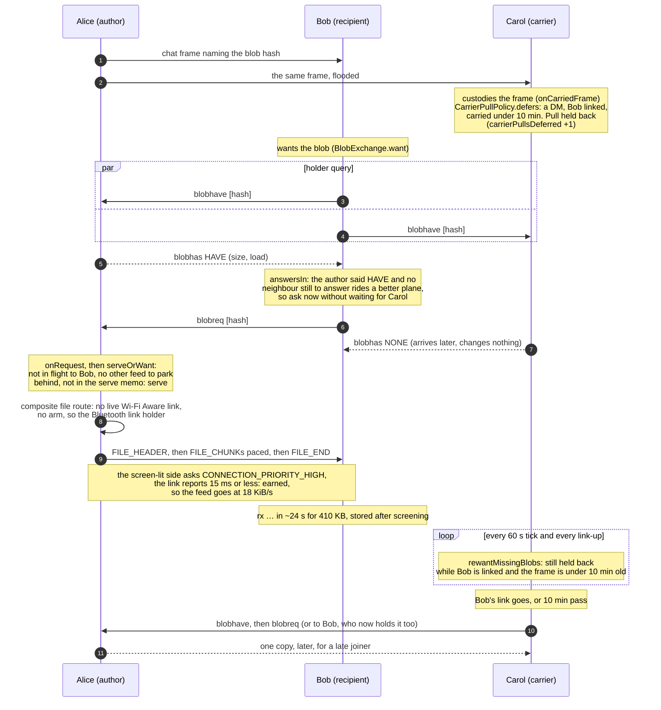
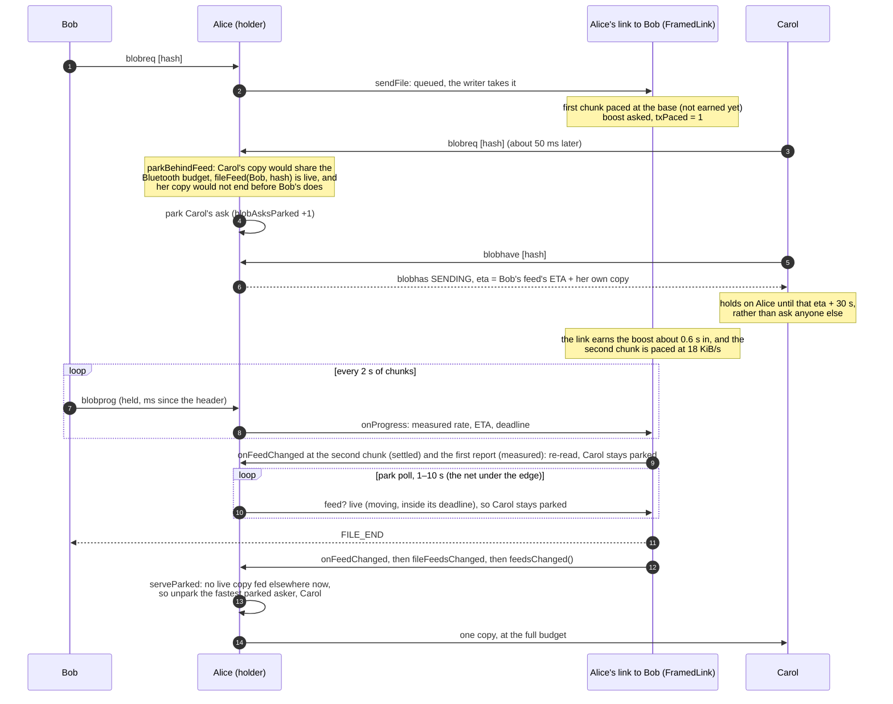
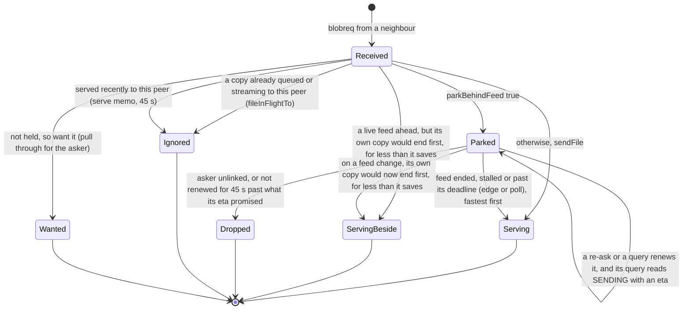
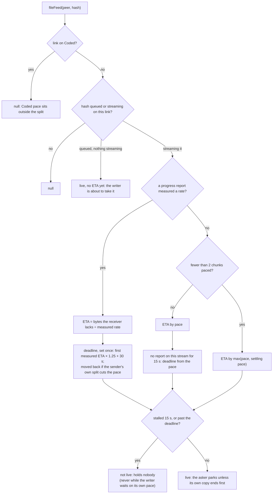
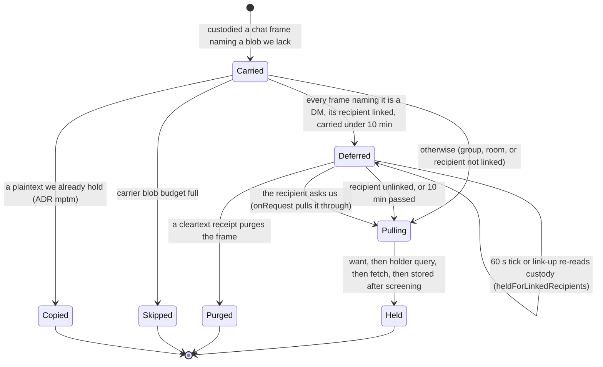
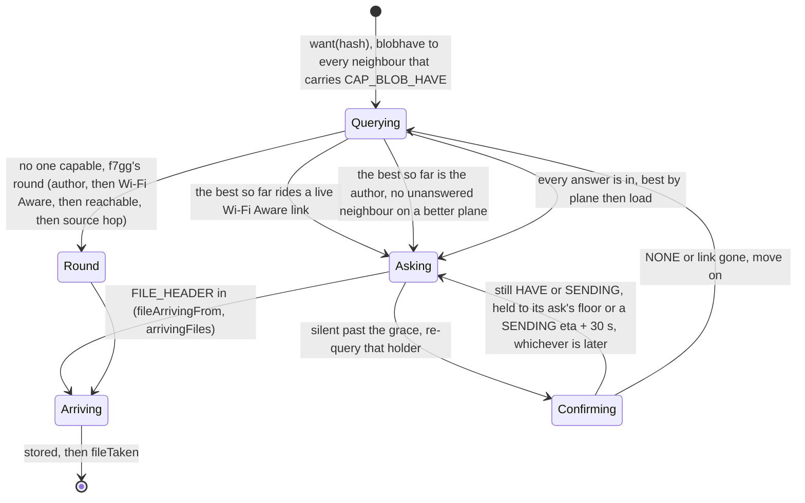
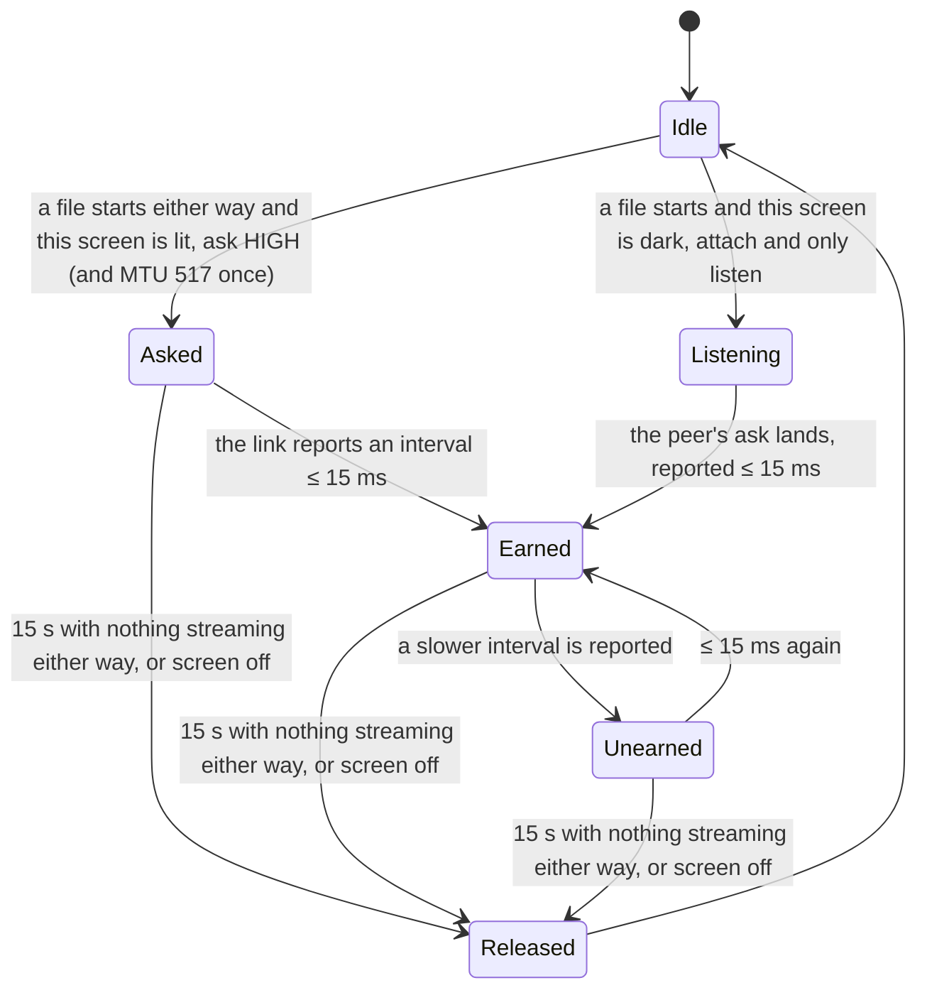

# How a picture is fetched over Bluetooth

**Status:** describes `main` at `3890f16b` plus ADR 2026-10.nsr7's phase 1 (2026-10-07). Since 2026-10-08 the holder
query, the link boost and the feed window are on in release builds; [`BLUETOOTH_PLANE.md`](BLUETOOTH_PLANE.md) covers
the feed window, which replaces the budgets below for a peer that reports its progress. The decisions behind it:

- ADR 2026-09.4tx5: serve only a fresh ask.
- ADR 2026-10.f7gg: ask the likeliest holder first.
- ADR 2026-10.6e5t: the holder query.
- ADR 2026-10.8jwn: one pace budget, split.
- ADR 2026-10.2da4: the link boost.
- ADR 2026-10.g24x: the linked recipient goes first, and the holder feeds one copy at a time, plus its settling-pace
  amendment.
- ADR 2026-10.nsr7: the receiver reports its progress, and the holder times its parked asks by it.

This page explains the logic as it stands. The ADRs hold the evidence and the rejected options.

An attachment is a content-addressed blob. A chat frame names it by hash, and the bytes travel separately: a peer that
wants them asks a neighbour that holds them, and the holder streams the file down its link. Nothing is pushed. Over
Wi-Fi Aware a file rides a fast data path. Over Bluetooth every copy competes for a few KiB/s, so on Bluetooth the
mesh controls **who asks**, **who is served first**, and **how fast each link is fed**.

## The rules ADR g24x and nsr7 added

1. **A carrier leaves a DM's picture to its recipient.** A phone that custodies a DM for someone else (a carrier)
   normally pulls the attachment too, so a late joiner can still get it. When the DM's recipient is linked to the
   carrier, the carrier waits up to 10 min instead. The recipient is fetching the picture right now, and a carrier
   pulling beside it is one more copy the author has to feed at the same time.
2. **The author's HAVE decides the fetch.** A receiver asks its neighbours who holds the blob. When the author answers
   HAVE, the receiver asks the author at once, without waiting for the other answers, unless a neighbour still to
   answer could offer a better plane.
3. **A holder feeds one Bluetooth copy of a blob at a time.** A second ask for a blob that is already streaming to
   someone else is parked, however long that feed takes. It is served when the feed ends, stalls (15 s with no
   progress) or runs past its deadline (its first measured ETA × 1.25 + 30 s). The fastest waiting asker goes next. An
   asker whose own copy would end before the feed does, and would save itself more than it costs the feeds it splits
   the budget with, goes beside it.
4. **Each link earns its own budget.** A link that has earned the boost feeds at the boosted budget, and one that has
   not feeds at the base. One slow link, such as an iPhone's, no longer holds every other link to the base.
5. **The receiver reports its progress.** Every 2 s of chunks, a file's receiver sends its sender a `blobprog`: the
   bytes it holds and the ms since the header, by its own clock. Not to an iPhone yet: its port does not take the type. That is what the sender's ETA, stall and deadline are
   measured from, because the Bluetooth stack's queue hides the drain from the sender.

## A DM photo to a linked recipient

Alice sends Bob a photo. Bob and Carol are both linked to Alice and to each other. Carol carries the DM, but it is
not for her.



If Bob is linked to Carol but not to Alice, Bob's own ask reaches Carol. `onRequest` on Carol then pulls the blob
through on Bob's behalf, and the hold never applies to that pull.

## A group photo several members want

Alice posts a photo to a group. Bob and Carol are both linked to her alone. Both get her HAVE within milliseconds and
ask her within milliseconds of each other.



Because a parked ask reads SENDING, Carol's holder query does not move on to another holder while she waits. Once Bob
holds the photo, he is a second source for anyone else.

With three askers, the third waits behind the second feed in turn. An iPhone's feed, which never earns the boost, is
the case the "beside" rule is for. Behind its 100 s copy, an Android asker whose 33 s copy would end first goes beside
it, and every slower asker still waits. It goes only when what it saves beats what the running feeds lose: while its
copy runs, each of them gets a smaller share and ends later.

## A holder's handling of one ask



A fresh ask is parked only when all of the following hold (`parkBehindFeed`):

- **A session to serve it later.** There is a live timer scope.
- **Not already covered.** The serve memo does not already cover the ask.
- **The copy rides the shared Bluetooth budget** (`ridesSharedBudget`):
  - **Live Wi-Fi Aware link:** never parked.
  - **Wi-Fi Aware reachable but not linked:** parked only below 128 KiB on a link that isn't slow. A larger blob is
    one the composite would raise a Wi-Fi Aware link for.
  - **Bluetooth only:** parked only if the link is not slow (Coded).
- **Another neighbour is being fed the same blob live** (`liveFeeds`, which calls `fileFeed`), and the asker's own copy,
  at the rate its link is expected to take, would not end before every live feed does (`waitsBehindFeed`). The rate
  (`expectedFileRate`) is its share of the pace, boosted only when the link will earn the boost (it earned within
  5 min, or this side is lit), times the shortfall its last measured stream showed against its pace (`drainRatio`).



The **settling pace** is the share the link will feed at once it has earned the boost. It is nonzero only while the
link has a boost that can earn, which means all of these:

- an Android peer (an iPhone link has no boost);
- `BLE_LINK_BOOST` and `LinkTuneDiag.boostOn` on;
- the link's tuner has not given up;
- no Bluetooth audio is streaming.

It lasts until the stream's second chunk is paced, and stands only until the first progress report measures a rate. It is counted in chunks, not time, because that pace is read after a
`delay`, which stops while the CPU sleeps. This covers the moment both receivers ask the author together: the first
chunk is paced before the link has answered the boost, so a 245 KB photo would otherwise read as a minute from its end
and the second ask would be fed in parallel.

## A carrier's pull decision



A sealed receipt is opaque to a carrier and purges nothing, so for an Android DM the 10 min window or the unlink is
what ends the hold. A recipient seen only over LoRa never holds anything back, because the hold reads the live
neighbour set.

## How a receiver picks whom to ask



The plane tiers, best first: fast link (Wi-Fi Aware linked), fast reach (Wi-Fi Aware reachable), Bluetooth link, slow
link (Coded), sending, blind, held.

**A large attachment is not fetched over Bluetooth until the user taps it** (ADR 2026-10.js2p). One its sender
declared over the user's "Ask before large Bluetooth downloads" limit (1 MB by default) is wanted *fast-only*: the
diagram above runs over the neighbours on the two Wi-Fi Aware tiers alone, every ask says `fastOnly`, and with neither
in reach nobody is queried or asked — no blind round, no pull-through over Bluetooth. A cycle that asked a reachable holder
and still wants the bytes backs off as a dead one does, until a Wi-Fi Aware link comes up. A holder serves such an ask over a
live Wi-Fi Aware link or one it raises, and otherwise drops it rather than feed it to Bluetooth. "Tap to download" wants
it plain, and from there it is fetched as this page describes. A room post declares its size too (ADR 2026-10.hmfe: an
attachment of 1 MB or more says so in the clear `ChatContent`), so a large room picture or video is held the same
way — by custody's want, which runs ahead of the delivery's, and by the tick's re-arm of a carried room post that no
row names yet, both judged by the size the post declares. A post that declares none (an older build, the iOS port) is
never held.

**A pull-through carries a hop budget and a deadline** (#195, ADR 2026-10.2drc). When no neighbour holds the blob, the
want asks the ones that lack it to pull it through, and each of them wants it in turn. Every ask says how many phones
deep it may still go: 3 from a want of our own, one less from each phone that echoes it, and at 0 a phone only queries
and fetches. So a holder four links away is still reached, and the echoes of one want stay within three rings. An ask
keeps a want alive only when it carries at least as much budget as the want itself, so echoes cannot keep each other
alive, or their root once it stops. Every ask also carries a deadline: for a DM's picture, the DM's custody window, the
24 h in which the mesh carries the DM itself. Past it nobody pulls the picture through or wants it for someone else. A
pull never needed a carrier, so the cost is a far end two or more hops away, reached again once the two ends link
directly. An older build's ask, and an iPhone's today, carry neither field: here they only ever make a fetch, and never
keep one alive. The iPhone itself still echoes without bound until its port carries the fields. Past two
cycles without a lead, a cycle that asked an iPhone blind and brought nothing backs off too. A want dead for a day, or
past its own deadline from its fifth dead cycle, backs off from 6 min into hours, unless it is fast-only.

## How fast a link is fed

The pace of a Bluetooth file is per link, read before every chunk (`BluetoothMeshTransport.paceFor`):

```text
budget(link) = 18 KiB/s  if the link has earned the boost and the phone has ≤ 4 LE connections
               12 KiB/s  if it has earned it with more than 4
                4 KiB/s  otherwise (the base)
share(link)  = budget(link) / number of links feeding a file now (1M/2M only)
chunk        = 2 s of the share, capped at 16 KiB
```

A Coded link keeps its own pace outside the split. A link to a peer that reports its progress is clocked by the feed
window instead (ADR 2026-10.5buf), and falls back to this pace when the receiver goes silent for 3 s. A link's boost
works like this:



Earning takes about 0.6 s on the lab Pixels, and the pace a feed reports moves at its next chunk, about 2 s after the
first. An iPhone link never boosts (its doorbell owns the parameters). Release builds ship with `BLE_LINK_BOOST` on since
2026-10-08.

## Bounds and costs

| Bound | Value | What it costs |
|---|---|---|
| Carrier hold (`CarrierPullPolicy.DEFER_MS`) | 10 min | A carrier linked to the recipient takes its own copy up to 10 min late. Every held pull lapses at once afterwards. |
| Progress report (`PROGRESS_EVERY_MS`) | 2 s | One small `blobprog` per incoming file every 2 s of chunks. A stall sends nothing. |
| Stall (`FeedMeter.STALL_MS`) | 15 s | A feed with no progress this long holds nobody: no report moved, or, before this stream's first report, no write went through. Never while the writer waits on its own pace. |
| Deadline | first ETA × 1.25 + 30 s | Set once, moved back if the sender's own split cuts the pace or its pace wait overslept. A feed past it holds nobody. An 8 MiB file at 18 KiB/s gets about 10 min. |
| Park poll | 1–10 s | Wakes when the soonest stall or deadline is due, at least every 10 s; a feed's end is served on its edge. |
| Asker's hold on a SENDING eta (`HOLD_SLACK_MS`, `HOLD_CAP_MS`) | eta + 30 s, at most 15 min | A holder that lies about its eta can hold an asker for up to 15 min. |
| Settle (`SETTLE_CHUNKS`) | 2 chunks | A link that never earns holds a parked ask for about one base chunk (2 s of feeding) on the guess. |
| Parked blobs (`MAX_PARKED_BLOBS`) | 64 | Past it, an ask is served rather than parked. |
| Serve memo (`SERVE_MEMO_MS`) | 45 s | A parked ask not renewed (by an ask or a query) for this long past its eta's promise is dropped. |

## Device results (2026-10-06, Wi-Fi Aware off)

- **DM, lit P3 to P7, with P8 and P9 as carriers:** five reps, each held in 27–31 s. Each was one copy at 18 KiB/s
  (23.8 s for 410 KB), and both carriers deferred.
- **Group, P3 the author, with the P9, P7 and P8 asking:** the later asks parked at once and stayed parked across the
  polls. Each `blob unpark` landed 3–4 ms after the previous feed's `file … in`. The third asker reached its 30 s
  bound mid-second-feed.
- **Dark P8 author on the chunk-counted build (before nsr7):**
  - **Lit asker first:** the next ask is unparked 7 ms after the feed ends.
  - **First copy to a dark pair:** the parked asks are released 2–3 s after their park.
  - **Boost off:** nothing parks.
  - **The open cost:** a dark pair's base-pace feed beside a lit one slows the lit copy from about 17 s to about 48 s.
    And a non-member carrier pulls a group photo at once, often first. Since ADR 2026-10.hr9f a non-member is also
    back-filled a group's frames by any holder, and pulls their photos at once when the author is not linked to it
    (`CarrierPullPolicy` holds the pull only while the author is), behind the members (nsr7) and inside
    `CARRIER_BLOB_BUDGET_BYTES`.
- **The iPhone shape, before nsr7:** a DM from the dark P7 to the lit P3 passed 5/5 at 35–40 s. A group photo the
  iPhone also asked for was fed four ways at once and took 138 s. That run is what nsr7 fixes; its device cells are
  owed.

## Where it lives

| Piece | Code |
|---|---|
| Carrier hold | `mesh/CarrierPullPolicy`, `InboundPipeline.onCarriedFrame`, `MeshManager.heldForLinkedRecipients`, `ForwardStore.carriedAttachments` |
| Query, choice and asks | `BlobExchange.want`, `onHaveQuery`, `onHaveAnswer`, `decide`, `answersIn` |
| Serve and park | `BlobExchange.onRequest`, `serveOrWant`, `parkBehindFeed`, `waitsBehindFeed`, `serveParked`, `feedsChanged`, `etaFor` |
| Is a copy being fed | `MeshTransport.fileFeed` / `expectedFileRate`, `BluetoothMeshTransport.fileFeed` / `boostedShare`, `FramedLink.feed`, `FeedMeter` |
| Progress reports | `FramedLink.onRxProgress` → `MeshTransport.fileProgress` → `BlobExchange.onFileProgress` → `blobprog` → `onProgressReport` → `FramedLink.onProgress` |
| Feed-change edge | `FramedLink.onFeedChanged`, then `MeshTransport.fileFeedsChanged`, then `MeshManager`'s collector |
| Pace and boost | `BluetoothMeshTransport.paceFor`, `CodedPhyPolicy.pace` / `budget`, `BleLinkBoost`, `LinkBoostPolicy` |
| File route | `CompositeMeshTransport.sendFile` (Wi-Fi Aware live link, then arm at 128 KiB or more, then Bluetooth) |
| Counters | `MeshMetrics.files()`: `blobAsksParked`, `blobProgressSent`, `blobProgressTaken`, `carrierPullsDeferred`; the debug bridge's `STATE` |
| Lab | `PictureFanoutLabTest`, `AttachmentLabTest`, `BlobHaveLabTest`, `BlobFirstAskLabTest` |
